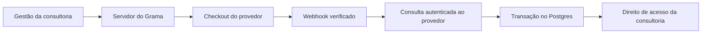

# Plano de segurança para o lançamento do Grama

Proposta para revisão técnica, baseada na `main` em `c2813c1`. A implementação pode ser dividida em PRs pequenos. A abertura de cobrança e a ampliação do piloto são decisões separadas.

## Estado do projeto

O frontend usa a Vercel e chama o Supabase diretamente. O banco define regras de acesso por linha (RLS) com vínculo ativo à consultoria, chaves compostas para relações entre registros e políticas para o bucket privado. A revisão estática das 17 migrations não confirmou acesso entre consultorias nos caminhos examinados. A configuração efetiva, os papéis e os objetos de produção precisam ser verificados separadamente. A [configuração de ambiente](setup.md) descreve projetos distintos para staging e produção.

A cobrança da assinatura do Grama é o requisito [BIL-01](arquitetura/02-requisitos-funcionais.md). Na revisão de referência, ela está em aberto e ainda não há integração de cobrança na `main`. O FIN-04 diz respeito às consultorias receberem dos próprios clientes. São fluxos que precisam de permissões e registros separados.

## Antes de ampliar o piloto

### Isolamento e recuperação dos dados

- Comparar as migrations aplicadas e as permissões efetivas de produção com a revisão aprovada. Verificar RLS, grants, funções privilegiadas, associação entre consultorias e permissões do Storage. Manter chaves privilegiadas no servidor, com escopo adequado ao serviço.
- Repetir em staging os cenários de acesso entre duas consultorias com usuários de Gestão, Equipe, membro desligado e visitante. Usar a API e o Storage diretamente. Incluir leitura, escrita, anexos, URLs assinadas, troca de papel e desligamento. Aproveitar a [suíte de isolamento](../supabase/tests/030_isolamento.test.sql) e a [suíte de Storage](../supabase/tests/060_storage_arquivos.test.sql).
- Definir perda de dados tolerável (RPO) e prazo de recuperação (RTO). Confirmar retenção e recuperação do banco e manter cópia separada dos arquivos. Restaurar ambos em ambiente isolado e validar políticas, vínculos e downloads. O backup do Postgres cobre os metadados do Storage. [Backups no Supabase](https://supabase.com/docs/guides/platform/backups)

### Disponibilidade e abuso

DDoS pode causar lentidão, indisponibilidade e custo. O isolamento dos registros depende da autorização do banco, enquanto a recuperação depende de backups testados. A mitigação de borda da Vercel cobre o tráfego que passa pela sua rede. Auth, API de dados, Storage e Edge Functions do Supabase também precisam de controles próprios porque o cliente as chama diretamente. [Mitigação de DDoS na Vercel](https://vercel.com/docs/vercel-firewall/ddos-mitigation) · [Checklist de produção do Supabase](https://supabase.com/docs/guides/deployment/going-into-prod)

- Mapear domínio, origem, rotas públicas, backend e ambientes. Conferir mitigação e regras ativas no provedor da borda. Verificar limites de Auth e proteção contra bots onde aplicável. Localizar o backend da lista de espera e validar separadamente permissões, formato, deduplicação e limites de envio.
- Definir limites por rota e por identidade confiável, conforme o fluxo. Usar limites por IP para tráfego anônimo e cotas por conta e consultoria em operações caras. Para uploads, medir tamanho, volume acumulado e frequência. Dimensionar conexões, índices e timeout das consultas críticas com dados de teste.
- Estabelecer alarmes para disponibilidade, erros, latência, saturação do banco, armazenamento e gasto com IA. Documentar responsáveis, contatos do provedor e como limitar ou suspender operações caras durante um incidente, preservando o cadastro manual. Evitar desafios de navegador no futuro endpoint de webhooks. Testar em staging os limites, a recuperação e o efeito no tráfego legítimo.

### Sessões, extração e publicação

| Frente           | Próxima entrega                                                                                                                                                                                                                        | Critério de aceite                                                                                                                                                                                                                                 |
| ---------------- | -------------------------------------------------------------------------------------------------------------------------------------------------------------------------------------------------------------------------------------- | -------------------------------------------------------------------------------------------------------------------------------------------------------------------------------------------------------------------------------------------------- |
| Bloqueio de tela | Para o piloto, tratar como privacidade visual ou substituir por saída com nova autenticação. Se a experiência de bloqueio seguro for obrigatória, desenhar controle de sessão no servidor e preservar rascunhos autorizados.           | O bloqueio visual é descrito como tal. Se houver promessa de bloqueio seguro, a sessão anterior não consegue ler nem escrever pela API, em nenhuma aba, até autenticar novamente. Testar com token anterior ainda dentro da validade.              |
| Extração de IA   | Reservar cota de forma atômica antes da chamada paga. Aplicar limites por conta, consultoria e projeto, incluindo concorrência. Manter janela, teto e orçamento configuráveis. Confirmar a chave e o teto de crédito de cada ambiente. | Solicitações concorrentes com documentos distintos respeitam a cota. Repetir o mesmo identificador não chama o provedor de novo. Falhas e timeouts liberam ou contabilizam a reserva conforme o custo real. O cadastro manual continua disponível. |
| CI e deploy      | Usar o banco descartável do CI na validação de PR. Reservar operações com credenciais remotas para código revisado, ambientes protegidos e credenciais de escopo separado. Vincular o deploy à revisão aprovada das migrations.        | PRs internos e de forks recebem apenas os privilégios da validação local. A revisão aprovada produz o mesmo identificador no banco e no frontend. Verificar controle de merge e revisão de mudanças nos workflows.                                 |

## Antes de liberar assinatura paga

### Modelo proposto

Começar com checkout hospedado em um provedor que ofereça ambiente de testes e consulta autenticada de pagamentos. O servidor cria a cobrança com o identificador interno da consultoria, plano, valor em centavos e moeda definidos pelo catálogo. O retorno do checkout pode mostrar o andamento. Somente o servidor concede acesso depois de confirmar o pagamento ou o direito de uso com o provedor.

- Verificar a autenticidade do webhook pelo método oficial do provedor, usando o conteúdo exato e a janela de validade quando exigidos. Conferir na API do provedor o estado atual, a conta recebedora e o ambiente, a cobrança esperada, a consultoria vinculada no servidor, o plano, o valor e a moeda.
- Persistir o identificador único do evento e da cobrança. Validar transições e atualizar cobrança, direito de acesso e auditoria em transação. Processar duplicatas, reenvios e eventos fora de ordem sem mudança indevida de acesso. Se a fonte oficial estiver indisponível ou houver divergência, manter o caso pendente para reprocessamento. Uma falha transitória não revoga uma assinatura ativa por si só.
- Distinguir pagamento pendente, confirmado, expirado, estornado ou contestado. Reconciliar periodicamente com o provedor. Aplicar as regras de renovação, suspensão e carência aprovadas pelo produto, inclusive quando a cobrança estiver atrasada.
- Restringir alterações de status e acesso aos serviços autorizados. Separar credenciais por ambiente e manter trilha com o mínimo de dados necessário. Dados de cartão ficam com o provedor. Screenshot, PDF, OCR, identificador enviado pelo navegador e página de sucesso não alteram a assinatura.
- Se o piloto exigir cobrança manual, usar confirmação do crédito na conta recebedora ou no painel oficial, vinculada à cobrança certa. Exigir permissão de operador, registrar a referência única da transação e auditar o responsável. Um comprovante pode ser material auxiliar de atendimento.

A Stripe é uma referência de implementação para webhooks e liberação posterior ao pagamento. A escolha do provedor e as regras de negócio ficam para revisão de produto. [Webhooks](https://docs.stripe.com/webhooks) · [Confirmação do checkout no servidor](https://docs.stripe.com/checkout/fulfillment?ui=full-page)

### Testes de aceite de cobrança

| Cenário                                                                                        | Resultado esperado                                                                            |
| ---------------------------------------------------------------------------------------------- | --------------------------------------------------------------------------------------------- |
| Comprovante falso ou reaproveitado, retorno manipulado ou chamada direta para marcar como pago | Acesso continua no estado anterior. Tentativa auditável, sem dados sensíveis em log.          |
| Webhook com assinatura inválida, ambiente de teste, recebedor ou referência errados            | Sem mudança de cobrança ou acesso.                                                            |
| Pagamento pendente, parcial ou com valor/moeda divergentes                                     | Acesso pago não é concedido. Divergência fica disponível para conciliação.                    |
| Evento repetido, simultâneo ou fora de ordem                                                   | Uma única transição válida. Estado antigo não reabre acesso revogado.                         |
| Evento válido para outra consultoria                                                           | Cada mudança afeta apenas a consultoria vinculada à cobrança no servidor.                     |
| Estorno, contestação ou falha temporária do provedor                                           | Reprocessamento e política de acesso funcionam sem perda de histórico nem liberação indevida. |

## Ordem de entrega e critérios de lançamento

1. Confirmar permissões de produção e preparar PRs de sessão, CI e cotas de IA. Ensaiar restauração e teste de carga com dados sintéticos em staging.
2. Fechar o BIL-01 com o time de produto. Decidir quem compra e administra o plano, métodos de pagamento, estados da assinatura, carência, cancelamento, estorno e acesso aos dados em caso de suspensão.
3. Implementar reconciliação e direito de acesso usando o sandbox do provedor. Validar os cenários da tabela e a recuperação após falha antes de habilitar a cobrança.
4. Habilitar por ambiente e por grupo de piloto, com métricas e alertas. Se houver incidente, pausar novas cobranças ou extrações conforme o sinal, preservar eventos e estado já confirmado e retomar por reconciliação. Registrar o exercício de rollback e o responsável de cada frente.
